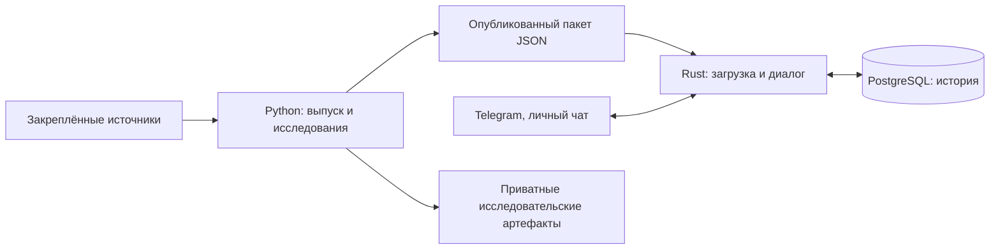

# Архитектура проекта

Бот работает в личном Telegram-чате на русском языке. Рабочий процесс Rust при старте проверяет выбранный неизменяемый пакет рекомендаций, подключается к PostgreSQL и затем опрашивает Telegram. Python готовит данные и рекомендации заранее; исследовательские оценки сами не меняют работающий пакет. [Первый запуск](../README.md#первый-запуск-через-docker-compose) и [обновление с откатом](../deploy/README.md#immutable-bundle-update-and-rollback) описаны отдельно.

Текстовая схема: закреплённые входные данные поступают в офлайн Python-подготовку. Она публикует проверенный пакет `catalog.json`, `neighbors.json`, `manifest.json`. Rust загружает именно этот пакет, ведёт Telegram-диалог и сохраняет события в PostgreSQL. Отдельные исследовательские артефакты не становятся рекомендациями в диалоге без явной подготовки и выбора нового пакета.

| Область | Точки входа и ответственность | Основное руководство |
| --- | --- | --- |
| Диалог и выдача | `bot/src/main.rs` запускает polling; `bot/src/handlers/`, `bot/src/dialogue/`, `bot/src/search.rs` обрабатывают команды, выбор и состояние; `bot/src/covers.rs` получает обложки. Один токен обслуживает один poller. | [Диалог](../bot/docs/dialogue.md), [рекомендации](../bot/docs/recommendations.md) |
| Хранилище | `bot/src/db.rs` и `bot/migrations/` сохраняют запросы, позиции выдачи, оценки аниме 1–10, оценки рекомендаций 0–5 и отзывы; миграции сохраняют прежнюю историю. | [База](../bot/docs/database.md) |
| Пакет для runtime | `src/recsys/release_prepare.py`, `release_build.py`, `export.py` готовят пакет; `bot/src/catalog/` читает его. Ключ записи — стабильный `MAL_ID`, а идентичность пакета основана на сырых байтах manifest. | [Выпуск](../recsys/RELEASE.md), [контракт пакета](../contracts/README.md), [экспорт](../recsys/EXPORT.md) |
| Исследования | `src/recsys/research_prepare.py`, `research_models.py`, `research_model_hybrid.py`, `research_predict.py`, `research_evaluate.py`, `research_campaign.py`, `research_resources.py` готовят выборку, модели, предсказания, оценку и ограниченную ресурсами кампанию. | [Протокол и ML-02](../recsys/RESEARCH.md) |
| Эксплуатация | `compose.yaml` и `deploy/` собирают выпуск отдельно от Rust-бота и управляют выбранным пакетом и томом PostgreSQL. | [Compose](../deploy/README.md), [приёмка](../deploy/LEVEL1_ACCEPTANCE.md) |

Текущий выпуск закрепляет базу Neelagiri 2025, алиасы Nafiul 2026 и GloVe через именованный lock. Исторический MAL 2020 выбирается явно. Исследовательская кампания фиксирует семь вариантов. В GPU-режиме popularity, ItemKNN и hybrid работают на CPU, а content-mean, content-max, content-union и PureSVD — на GPU; hybrid использует две дополнительные CPU-подготовки компонентов. В CPU-режиме все семь вариантов работают на CPU. Код, научные входы, выходы и ресурсы связываются идентичностями, а вывод о качестве требует отдельного измерения. [Проверяемые границы Python-модулей](python-boundaries.md) фиксируют зависимости текущих подсистем. [Версионирование входов через DVC](data-versioning.md) хранит указатели пяти выбранных входов в Git и байты в приватном локальном remote; их восстановление в новой рабочей копии выполняется отдельно. Опубликованный runtime-пакет создаётся и выбирается отдельно.

## Контракты и происхождение

- [Формат пакета](../contracts/README.md) и его три схемы задают общую границу Python/Rust. Оба валидатора проверяют одни и те же байты; `manifest.json` связывает источники и два файла пакета.
- [Research-протокол](../recsys/RESEARCH.md) и [выпуск](../recsys/RELEASE.md) задают разные границы доверия. ML-01 связывает семь конкретных файлов `CODE_FILES` и их хеши; ML-02 связывает имена и хеши производителей. Текущий выпуск закрепляет пять producer-файлов. Миграция [arb053-python-src-v1](migrations/arb053-python-src-v1.md) сохранила относительные имена и байты пакета при переносе родительского каталога. Будущие внутренние перемещения producer-файлов или изменение их байтов требуют отдельной версии и проверки; старые манифесты не переписывают.
- [Сравнение ARB-018](../recsys/reports/arb018-v1/README.md) сохраняет исторические идентичности; удалённый Python-бот восстанавливается из указанной в [миграции layout](migrations/arb053-python-src-v1.md) ревизии Git. Текущий Python-пакет находится в [src/recsys](../src/README.md).
- Git хранит код, небольшие метаданные и DVC-указатели. Пароли, токены, полные результаты исследований, скрытые метки, пользовательские данные и частные свидетельства приёмки остаются вне коммитов и публичных отчётов.
